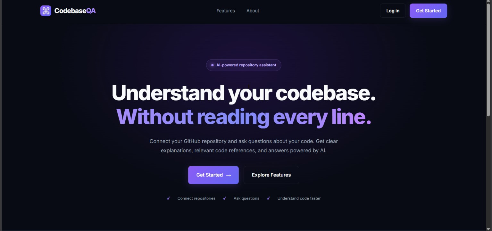
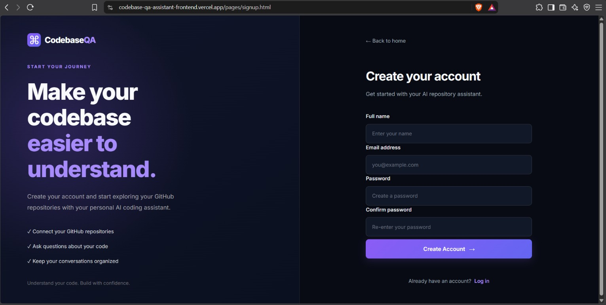
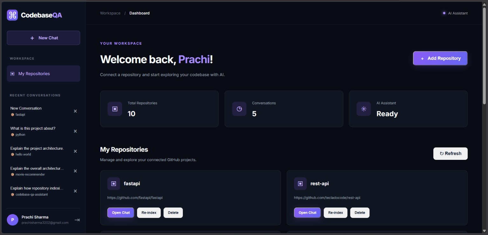
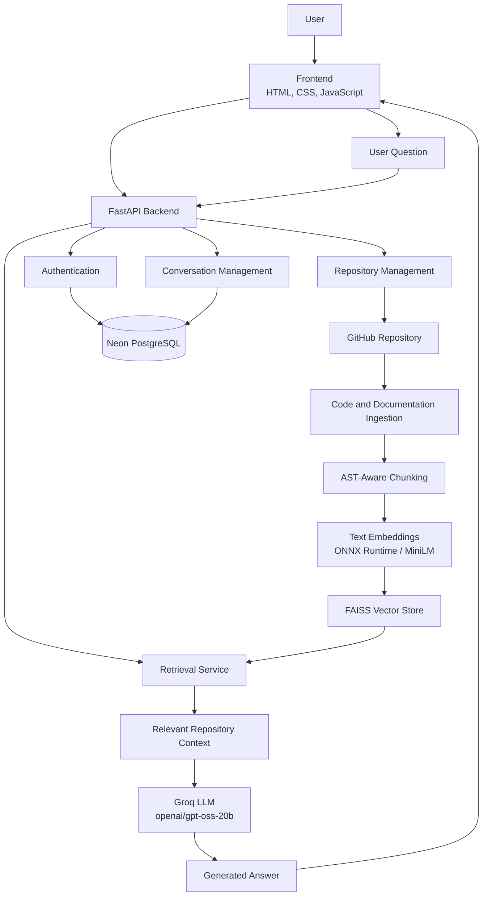

# Codebase QA Assistant

An AI-powered codebase companion that helps developers understand GitHub repositories through natural-language questions. It uses Retrieval-Augmented Generation (RAG) to retrieve relevant code and documentation before generating repository-grounded answers.

**GitHub Repository:** [prachishr/codebase-qa-assistant](https://github.com/prachishr/codebase-qa-assistant)

---
### 🚀 Live Demo

[Open Codebase QA Assistant](https://codebase-qa-assistant-frontend.vercel.app/)

## Overview

Codebase QA Assistant turns a GitHub repository into a searchable knowledge base. Users can connect a repository and ask questions about its purpose, implementation, architecture, functions, and documentation.

Instead of sending an entire repository to an LLM, the application:

1. Clones and processes the repository.
2. Extracts relevant source code and documentation.
3. Splits content into meaningful chunks.
4. Generates vector embeddings.
5. Retrieves relevant context using FAISS.
6. Sends the selected context to a Groq-hosted language model.
7. Returns answers based on the retrieved repository content.

The application also provides user authentication and PostgreSQL-backed conversation history, allowing users to revisit previous chats.

---

<p align="center">
  
  
  
  
  
  
  
</p>

## Application Screenshots

### Main Page
The main interface of Codebase QA Assistant.



### Login Page
User authentication interface for accessing the application.



### Dashboard
Displays indexed repositories and conversation history, allowing users to manage their codebase interactions.



---

## Features

- **User Authentication & Account Recovery:** Sign-up, login, sign-out, change password, and forgot/reset password using single-use reset links sent via SMTP (with terminal fallback in local dev).
- **GitHub Repository Connection:** Clone, index, re-index, and delete supported public repositories with `Indexed` / `Not Indexed` status badges.
- **Background Indexing & Live Progress:** Asynchronous repository indexing and re-indexing with status polling.
- **Repository-Aware Question Answering:** Ask questions about the connected codebase with one-click suggested prompts.
- **Code and Documentation Ingestion:** Process source files and project documentation.
- **AST-Aware Code Chunking:** Identify meaningful code structures such as functions, methods, and classes where supported (with automatic text-based fallback).
- **Local ONNX Semantic Search:** Generate 384-dimensional `all-MiniLM-L6-v2` embeddings locally using ONNX Runtime and HuggingFace `tokenizers` — completely free with no API keys, PyTorch overhead, or daily rate limits.
- **FAISS Vector Search:** Retrieve relevant repository chunks with in-memory index caching and dimension validation.
- **Hybrid Retrieval:** Combine keyword, code-symbol, project-overview, and semantic retrieval strategies.
- **Groq-Powered Responses:** Generate answers using retrieved repository context.
- **Source References:** Display relevant source files alongside answers.
- **Persistent Conversations:** Store chat history in Neon PostgreSQL and revisit previous chats.
- **Light & Dark Themes:** Persistent theme toggle across all pages.

---

## Architecture

The application follows a Retrieval-Augmented Generation (RAG) architecture to answer questions about GitHub repositories.



### RAG Workflow

1. The user connects a GitHub repository.
2. The backend clones and processes the repository.
3. Source code and documentation are divided into meaningful chunks.
4. Local ONNX Runtime (`all-MiniLM-L6-v2`) generates 384-dim vector embeddings.
5. FAISS stores the embeddings locally for similarity search.
6. The user submits a question through the frontend.
7. The retrieval service finds relevant repository content.
8. Retrieved context is passed to the Groq LLM.
9. The generated answer is returned to the frontend.
10. Conversation history is stored in Neon PostgreSQL.

### RAG Pipeline

**1. Repository Ingestion**

The application clones a supported public GitHub repository and extracts relevant source-code files and documentation.

**2. Chunking**

Code and documentation are processed according to their content:

- **Code:** AST-aware parsing identifies meaningful structures such as functions, methods, and classes for supported languages.
- **Documentation:** Markdown and text content are divided into smaller chunks.
- **Project Overview:** The root README receives particular importance for project-level questions.

**3. Embeddings**

Text chunks are converted into 384-dimensional vector embeddings using:

`sentence-transformers/all-MiniLM-L6-v2` (via **ONNX Runtime** + **HuggingFace `tokenizers`**)

The embedding model runs 100% locally on CPU without PyTorch or external embedding API limits.

**4. Retrieval**

The retrieval layer uses strategies such as:

- Project-overview retrieval
- Keyword matching
- Code-symbol and function matching
- FAISS semantic similarity search
- Duplicate reduction
- Source prioritization

**5. Answer Generation**

Retrieved chunks are assembled into context and passed to the Groq language model.

**LLM:** `openai/gpt-oss-20b`

The model generates answers using the supplied repository context.

---

## Authentication and Conversation History

The FastAPI backend handles authentication and application APIs. PostgreSQL stores persistent application data, including conversation history.

The database layer uses SQLAlchemy's asynchronous interface with `asyncpg` to communicate with the PostgreSQL database hosted on Neon.

Conversation history is associated with the authenticated user. Conversations can also be associated with repositories, allowing users to identify which repository a previous chat belongs to.

---

## Technology Stack

| Technology | Purpose |
|---|---|
| Python | Backend programming language |
| FastAPI | Backend API framework |
| HTML | Frontend structure |
| CSS | Frontend styling |
| JavaScript | Frontend interactions and API requests |
| SQLAlchemy (Async) | Asynchronous database operations |
| asyncpg | PostgreSQL driver |
| Neon PostgreSQL | Hosted relational database |
| GitPython | GitHub repository cloning and Git operations |
| Tree-sitter | AST-based code parsing |
| LangChain | Document and vector-store integration |
| ONNX Runtime & Tokenizers | Lightweight local embedding inference (no PyTorch) |
| FAISS | Vector similarity search |
| Groq | LLM inference |
| smtplib (Python stdlib) | Password reset emails via SMTP |
| python-dotenv | Environment variable configuration |

### Core AI Components

| Component | Model |
|---|---|
| Embedding Model | `sentence-transformers/all-MiniLM-L6-v2` (ONNX) |
| LLM | `openai/gpt-oss-20b` |

---

## Project Structure

```text
Codebase-QA-Assistant/
│
├── backend/
│   └── app/
│       ├── main.py
│       ├── api/
│       │   └── v1/
│       │       ├── auth.py
│       │       ├── conversations.py
│       │       └── repositories.py
│       ├── core/
│       │   ├── config.py
│       │   ├── dependencies.py
│       │   └── security.py
│       ├── db/
│       │   ├── database.py
│       │   └── init_db.py
│       ├── models/
│       ├── schemas/
│       └── services/
│           ├── email_service.py
│           ├── github_service.py
│           └── rag_service.py
│
├── core/
│   ├── chunking.py
│   ├── ingestion.py
│   ├── rag.py
│   ├── retrieval.py
│   ├── vector_store.py
│   └── __init__.py
│
├── frontend/
│   ├── index.html
│   ├── pages/
│   │   ├── login.html
│   │   ├── signup.html
│   │   ├── reset-password.html
│   │   └── dashboard.html
│   ├── css/
│   │   ├── style.css
│   │   ├── auth.css
│   │   └── dashboard.css
│   └── js/
│       ├── api.js
│       ├── auth.js
│       ├── dashboard.js
│       ├── chat.js
│       └── theme.js
│
├── workspaces/
├── run.py
├── requirements.txt
├── .gitignore
├── .env
└── README.md
```

Generated repository files and vector indexes are created locally as needed and excluded from Git.

---

## Local Setup
Follow these steps to run Codebase QA Assistant on your local machine
### Prerequisites

Before running the project, make sure you have:

- Python installed
- Git installed
- A Groq API key
- A PostgreSQL database (the project uses Neon)

### 1. Clone the Repository

```bash
git clone https://github.com/prachishr/codebase-qa-assistant.git
cd codebase-qa-assistant
```

### 2. Create a Virtual Environment

```bash
python -m venv .venv
```

### 3. Activate the Virtual Environment

**Windows PowerShell:**

```powershell
.\.venv\Scripts\Activate.ps1
```

### 4. Install Dependencies

```bash
pip install -r requirements.txt
```

### Step 5: Configure Environment Variables

Create a `.env` file in the root directory of the project.

Add the following environment variables:

```env
APP_NAME="Codebase QA Assistant API"
APP_ENV=development

DATABASE_URL=your_neon_postgresql_connection_string
GROQ_API_KEY=your_groq_api_key
JWT_SECRET_KEY=your_secure_jwt_secret

FRONTEND_URL=http://localhost:5173
ACCESS_TOKEN_EXPIRE_MINUTES=30
PASSWORD_RESET_EXPIRE_MINUTES=15

# Optional (for Forgot Password emails; if omitted, reset link logs to backend terminal)
SMTP_HOST=smtp.gmail.com
SMTP_PORT=587
SMTP_USER=your_gmail@gmail.com
SMTP_PASSWORD=your_16_char_app_password
SMTP_FROM_EMAIL=your_gmail@gmail.com
```

Replace the placeholder values with your actual credentials.

| Variable | Description |
|---|---|
| `APP_NAME` | Application name |
| `APP_ENV` | Application environment |
| `DATABASE_URL` | Neon PostgreSQL connection string |
| `GROQ_API_KEY` | API key used for Groq |
| `JWT_SECRET_KEY` | Secret key used for JWT authentication |
| `FRONTEND_URL` | Frontend application URL |
| `ACCESS_TOKEN_EXPIRE_MINUTES` | Access token expiration time in minutes |
| `PASSWORD_RESET_EXPIRE_MINUTES` | Reset link expiration time in minutes (default `15`) |
| `SMTP_HOST` / `SMTP_PORT` | SMTP server and TLS port (default `smtp.gmail.com` / `587`) |
| `SMTP_USER` / `SMTP_PASSWORD` | SMTP login email and App Password (optional in local dev) |
| `SMTP_FROM_EMAIL` | Sender email address for password reset emails |

**Important:** Never commit your `.env` file to GitHub or expose your API keys, database credentials, or JWT secret.

### 6. Run the FastAPI Backend

From the project root, execute:

```bash
python run.py
```

Or directly via `uvicorn` (excluding `workspaces/` from reload watching):

```bash
python -m uvicorn backend.app.main:app --reload --reload-dir backend --reload-dir core
```

*(Using `run.py` or `--reload-dir backend --reload-dir core` prevents `uvicorn` from restarting when repositories are cloned into `workspaces/`.)*

The backend will be available at:

`http://127.0.0.1:8000`

### 7. Access API Documentation

FastAPI provides interactive API documentation at:

`http://127.0.0.1:8000/docs`

Health endpoint:

`http://127.0.0.1:8000/health`

### 8. Open the Frontend

Open `frontend/index.html` using a local static server, such as the VS Code Live Server extension (`http://127.0.0.1:5500`).

`frontend/js/api.js` automatically uses `http://127.0.0.1:8000/api/v1` when opened on `localhost` / `127.0.0.1`, and the deployed Render backend in production.

---

## Example Questions

After connecting a repository, users can ask:

- What is this project about?
- Explain the project architecture.
- How does the `loadRules` function work?
- Which file handles authentication?
- Where is the database connection created?
- What are the main technologies used in this repository?
- Explain the flow of data through this application.

---

## Why These Technologies?

| Technology | Reason |
|---|---|
| RAG | Grounds LLM responses in retrieved repository content |
| FastAPI | Provides a structured backend API |
| HTML, CSS, and JavaScript | Provides a separate frontend |
| Tree-sitter | Helps identify meaningful code structures |
| ONNX Runtime (MiniLM) | Generates lightweight 384-dim embeddings locally without PyTorch |
| FAISS | Enables local vector similarity search |
| Groq | Provides LLM inference |
| PostgreSQL | Stores persistent relational application data |
| Neon | Hosts the PostgreSQL database |

### Why FAISS Instead of ChromaDB?

ChromaDB was initially explored for vector storage, but the Windows environment encountered a `cygrpc` DLL loading issue related to an Application Control policy.

FAISS provided the required local vector similarity search without the problematic gRPC dependency, so the project moved to FAISS.

---

## Current Limitations

- The application currently supports public GitHub repositories.
- Repository cloning uses a shallow clone, so the full Git history is not available.
- Very large repositories may require additional processing time.
- Repository workspaces and FAISS indexes are stored in the application's local workspace.
- Local or ephemeral deployment storage may require repository re-ingestion and index regeneration after a restart or redeployment.
- Private repository access is not currently provided through a GitHub OAuth integration.

---

## Future Improvements

- GitHub OAuth and private repository support
- Full Git history analysis
- Support for additional programming languages
- Improved retrieval and reranking
- Repository dependency visualization
- Streaming LLM responses
- Persistent vector-index storage (e.g., `pgvector` / Qdrant)
- Improved code and source highlighting
- Repository-aware code generation

---

## Project Highlights

Generative AI · Large Language Models · Retrieval-Augmented Generation · Semantic Search · Vector Embeddings · FAISS · AST Parsing · Code Intelligence · GitHub Integration · FastAPI · JavaScript · PostgreSQL · Authentication

---

## Author

**Prachi Sharma**

GitHub: [prachishr](https://github.com/prachishr)

Project Repository: [codebase-qa-assistant](https://github.com/prachishr/codebase-qa-assistant)

If you find this project useful, consider giving the repository a ⭐ on GitHub.
