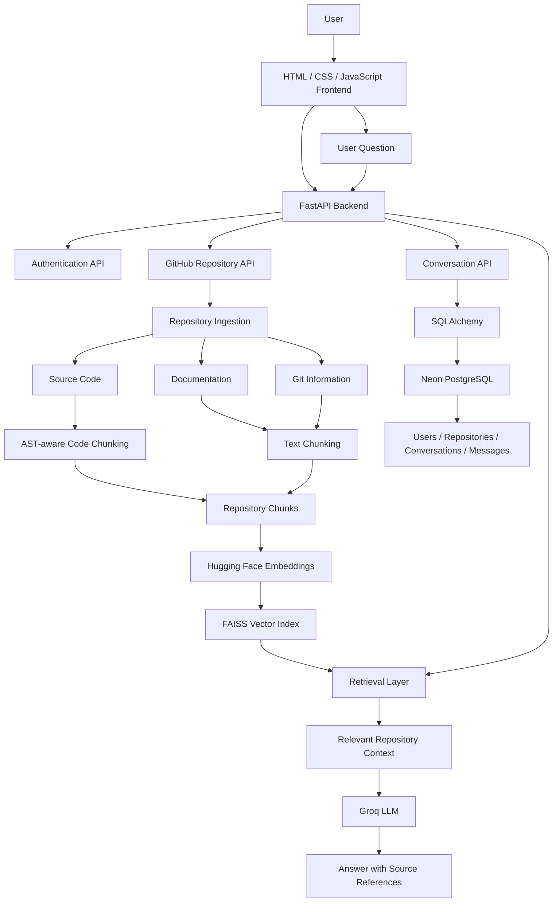

# Codebase QA Assistant

An AI-powered codebase companion that helps developers understand GitHub
repositories through natural-language questions. It uses
Retrieval-Augmented Generation (RAG) to retrieve relevant code and
documentation before generating repository-grounded answers.

GitHub:
[prachishr](https://github.com/prachishr/codebase-qa-assistant)

### Overview
Codebase QA Assistant turns a public GitHub repository into a searchable
knowledge base. Users can connect a repository and ask questions about
its purpose, implementation, architecture, functions, and documentation.

Instead of sending an entire repository to an LLM, the application: 1.
Clones and processes the repository. 2. Extracts relevant source code,
documentation, and available Git information. 3. Splits content into
meaningful chunks. 4. Generates vector embeddings. 5. Retrieves relevant
context using the retrieval layer and FAISS. 6. Sends the selected
context to a Groq-hosted language model. 7. Returns an answer grounded
in the repository, with source-file references.

The application also provides user authentication and PostgreSQL-backed
conversation history, allowing users to revisit previous chats.
Features
- User authentication: Sign-up and login through the FastAPI
  backend.
- GitHub repository connection: Clone and analyze supported public
  repositories.
- Repository-aware question answering: Ask questions about the
  connected codebase.
- Code and documentation ingestion: Process source files and
  project documentation.
- AST-aware code chunking: Preserve useful code structures such as
  functions, methods, and classes where supported.
- Semantic search: Generate embeddings with
  sentence-transformers/all-MiniLM-L6-v2.
- FAISS vector search: Retrieve relevant repository chunks
  efficiently.
- Hybrid retrieval logic: Combine project-overview, keyword,
  code-symbol, and semantic retrieval strategies.
- Groq-powered responses: Generate answers using retrieved
  repository context.
- Source references: Show relevant source files alongside answers.
- Persistent conversations: Store chat history in PostgreSQL.
- Previous chats: Reopen earlier conversations and see their
  associated repository.

### Architecture

#### RAG Pipeline
1. Repository ingestion
The application clones a supported public GitHub repository and extracts
relevant source-code files, documentation, and available Git
information.
2. Chunking
Code and documentation are processed according to their content: -
Code: AST-aware parsing is used for supported languages to identify
meaningful structures such as functions, methods, and classes. -
Documentation: Markdown and text content are split into smaller
chunks for retrieval. - Project overview: The root README.md
receives particular importance for project-level questions.
3. Embeddings
Text chunks are converted into vector embeddings using:
sentence-transformers/all-MiniLM-L6-v2
The embedding model runs locally and does not require a Hugging Face API
token for ordinary local embedding generation.
4. Retrieval
The retrieval layer uses relevant strategies such as: - Project-overview
retrieval - Keyword matching - Exact code-symbol and function matching -
FAISS semantic similarity search - Duplicate reduction - Source
prioritization
5. Answer generation
Retrieved chunks are assembled into context and passed to the Groq
language model.

###### Current model:
openai/gpt-oss-20b
The model is instructed to answer using the supplied repository context
rather than inventing unsupported implementation details.
Authentication and Conversation History
The FastAPI backend handles authentication and application APIs.
PostgreSQL stores persistent application data, including conversation
history.

The database layer uses SQLAlchemy's asynchronous interface with
asyncpg to communicate with the PostgreSQL database hosted on Neon.

Conversation history is associated with the relevant authenticated user.
Conversations can also be associated with repositories, allowing the
interface to show which repository a previous chat belongs to.
User
 |
 +---- Repository
 |
 +---- Conversation
          |
          +---- Message
          |
          +---- Message
#### Technology Stack
  Technology              Purpose
  Python                  Backend language
FastAPI                 Backend API framework
HTML                    Frontend structure
CSS                     Frontend styling
JavaScript              Frontend interactions and API requests
SQLAlchemy (Async)      Asynchronous database operations
asyncpg                 PostgreSQL driver
Neon PostgreSQL         Hosted relational database
GitPython               GitHub repository cloning and Git operations
Tree-sitter             AST-based code parsing
LangChain               Document and vector-store integration
Sentence Transformers   Local embedding generation
Hugging Face            Embedding model ecosystem
FAISS                   Vector similarity search
Groq                    LLM inference
python-dotenv           Local environment configuration
Core AI components
Embedding model
sentence-transformers/all-MiniLM-L6-v2
LLM
openai/gpt-oss-20b

#### Project Structure
Codebase-QA-Assistant/
│
├── backend/
│   └── app/
│       ├── main.py
│       ├── api/
│       │   └── v1/
│       │       ├── auth.py
│       │       ├── conversations.py
│       │       └── repositories.py
│       ├── core/
│       │   ├── config.py
│       │   ├── dependencies.py
│       │   └── security.py
│       ├── db/
│       │   ├── database.py
│       │   └── init_db.py
│       ├── models/
│       ├── schemas/
│       └── services/
│           ├── github_service.py
│           └── rag_service.py
│
├── core/
│   ├── chunking.py
│   ├── ingestion.py
│   ├── rag.py
│   ├── retrieval.py
│   ├── vector_store.py
│   └── __init__.py
│
├── frontend/
│   ├── index.html
│   ├── pages/
│   │   ├── login.html
│   │   ├── signup.html
│   │   └── dashboard.html
│   ├── css/
│   │   ├── style.css
│   │   ├── auth.css
│   │   └── dashboard.css
│   └── js/
│       ├── api.js
│       ├── auth.js
│       ├── dashboard.js
│       └── chat.js
│
├── workspaces/              # Local repository workspaces (generated)
├── requirements.txt
├── .gitignore
├── .env                     # Local environment variables (not committed)
└── README.md

Generated repository files and vector indexes are created locally as
needed and are excluded from Git.
Local Setup

#### Prerequisites
- Python installed
- Git installed
- A Groq API key
- A PostgreSQL database (the project uses Neon)

1. Clone the repository
git clone https://github.com/prachishr/codebase-qa-assistant.git
cd codebase-qa-assistant
2. Create a virtual environment
python -m venv .venv
Windows PowerShell:
.\.venv\Scripts\Activate.ps1
3. Install dependencies
pip install -r requirements.txt
4. Configure environment variables
Create a .env file in the project root and add the configuration
required by backend/app/core/config.py.

Typical settings include:
GROQ_API_KEY=your_groq_api_key
DATABASE_URL=your_neon_postgresql_connection_string
SECRET_KEY=your_application_secret
Use the exact variable names expected by your application configuration.
Do not commit .env or share its values publicly.
5. Start the FastAPI backend
From the project root, run:
python -m uvicorn backend.app.main:app --reload
The backend will be available at:
http://127.0.0.1:8000
6. Open the API documentation
FastAPI provides interactive API documentation at:
http://127.0.0.1:8000/docs
The health endpoint can be checked at:
http://127.0.0.1:8000/health
7. Open the frontend
Open frontend/index.html using a local static server, such as the VS
Code Live Server extension. The frontend must be configured to send API
requests to the running backend.
Environment and Security
- Keep API keys, database credentials, and application secrets in
  environment variables.
- Do not commit .env to Git.
- Configure production environment variables through the hosting
  provider's environment settings.
- Use a strong, unique application secret in production.
- Restrict cross-origin requests to the frontend origin in production.
- Ensure conversation and repository operations enforce the
  authenticated user's access permissions.
Example Questions
After connecting a repository, users can ask:
- What is this project about?
- Explain the project architecture.
- How does the loadRules function work?
- Which file handles authentication?
- Where is the database connection created?
- What are the main technologies used in this repository?

##### Why These Technologies?
  Technology / Approach               Reason
  RAG                                 Grounds LLM responses in retrieved
repository content

  FastAPI                             Provides a structured API backend

  HTML, CSS, and JavaScript           Provides a separate frontend

  Tree-sitter / AST                   Helps preserve meaningful code
structures during chunking

  MiniLM embeddings                   Provides lightweight local semantic
representations

  FAISS                               Enables local vector similarity
search

  Groq                                Provides LLM inference

  PostgreSQL                          Stores persistent relational
application data
Neon                                Hosts the PostgreSQL database
Why FAISS instead of ChromaDB?
ChromaDB was initially explored for vector storage, but the Windows
environment encountered a cygrpc DLL loading issue related to an
Application Control policy.

FAISS provided the required local vector similarity search without the
problematic gRPC dependency, so the project moved to FAISS.
Current Limitations
- The application currently supports public GitHub repositories.
- Repository cloning uses a shallow clone, so the full Git history is
  not available.
- Very large repositories may require additional processing time.
- Repository workspaces and FAISS indexes are stored in the
  application's local workspace.
- Local or ephemeral deployment storage may require repository
  re-ingestion and index regeneration after a restart or redeployment.
- Private repository access is not currently provided through a GitHub
  OAuth integration.

#### Future Improvements
- GitHub OAuth and private repository support
- Full Git history analysis
- More programming-language support
- Improved retrieval and reranking
- Repository dependency visualization
- Streaming LLM responses
- Background repository indexing
- Persistent vector-index storage
- Improved code and source highlighting
- Repository-aware code generation

#### Project Highlights
Generative AI · Large Language Models · Retrieval-Augmented Generation
· Semantic Search · Vector Embeddings · FAISS · AST Parsing · Code
Intelligence · GitHub Integration · FastAPI · JavaScript · PostgreSQL ·
Authentication
Author
Prachi Sharma

GitHub: [prachishr](https://github.com/prachishr)

Project repository: [codebase-qa-assistant](https://github.com/prachishr/codebase-qa-assistant)

If you find this project useful, consider giving the repository a ⭐ on
GitHub.
